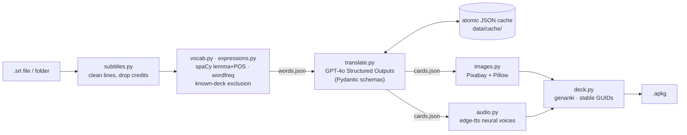

# anki-series

[](https://www.python.org/)
[](https://github.com/WinterSage11/anki-series/actions/workflows/ci.yml)
[](LICENSE)

A Python CLI that turns the English `.srt` subtitles of a TV series into a ready-to-import Anki deck (`.apkg`).
It picks the most frequent lemmas and multiword expressions, attaches a real line from the show, translates it in context to Mexican/Latin American Spanish, and bundles images and neural-voice audio into the deck.

| Front | Back |
|---|---|
|  |  |

## Architecture

A hybrid pipeline: deterministic NLP does the counting and filtering (cheap, reproducible), and the LLM is used only where context matters (translation and judging idioms). Every stage writes inspectable JSON and can be re-run on its own.



## Results (real run)

One full season run (*How I Met Your Mother*, S04; subtitles not included in the repo):

| Metric | Value |
|---|---|
| Clean subtitle sentences | 10,336 |
| Cards generated | 350 (309 words + 41 expressions) |
| OpenAI calls on re-run (warm cache) | 0 |
| Test suite | 253 tests, fully offline (OpenAI, Pixabay and TTS mocked) |

## Engineering decisions

- **Hybrid NLP + LLM.** spaCy (`en_core_web_sm`) and `wordfreq` handle lemmatization, POS, frequency and filtering (proper nouns, interjections, fillers, stopwords) deterministically. GPT-4o is only called for contextual translation and to judge whether a multiword candidate is a real idiom — the expensive model never sees text a rule could handle.
- **Cost control with atomic, versioned caches.** Every LLM result is cached in `data/cache/` with a key of `prompt version + model + input`, saved atomically (temp file + `replace`) after each batch, so a crash or `Ctrl+C` never loses paid work. Three independent version constants — `PROMPT_VERSION` (word translation), `EXPRESSION_PROMPT_VERSION` (expression translation) and `EXPR_FILTER_VERSION` (idiom filter) — let one prompt change without invalidating the other caches.
- **Batched Structured Outputs.** `chat.completions.parse` with Pydantic response models gives typed, validated results. Translation runs in batches of 20 cards; the idiom filter runs in batches of 80 candidates. Field order in the schema is deliberate: the model writes `phrase` / `phrase_translation` before `translation`, so a phrasal verb in the example doesn't leak into the single-word translation.
- **Real NLP bugs, fixed with tests.**
  - *Phrasal verbs crowded out by noise:* frequent n-grams filled the whole candidate pool, so the 400-candidate cap (`MAX_CANDIDATES`) now reserves a separate budget of 200 for phrasal verbs (`MAX_PHRASAL_CANDIDATES`).
  - *Duplicate cards from POS noise:* spaCy tagged `dude` as a verb now and then, producing near-duplicate notes. `vocab.merge_pos` keeps a single POS per lemma (the most frequent), summing frequencies.
  - *Wrong lemma:* spaCy lemmatizes `born` as `bear/VERB`; a surface-form override maps it to `born/ADJ`, applied both in counting and in highlighting.
- **Safe re-imports.** The genanki model ID is a fixed constant, deck IDs are derived from the series name and note GUIDs from `(series, lemma, POS)`, so importing a regenerated deck updates existing notes and keeps study progress. Media file names are content-hashed because Anki's media folder is global.

## Quickstart

Requires [uv](https://docs.astral.sh/uv/) (it installs Python 3.12 and the spaCy model for you).

```bash
git clone https://github.com/WinterSage11/anki-series.git && cd anki-series
uv sync
```

**Offline demo (~10 seconds, no API keys)** — builds a deck skeleton (English only) from a synthetic subtitle file:

```bash
uv run anki-series extract examples/sample.srt --series "Demo" --top 30 -o data/demo/words.json
uv run anki-series build -i data/demo/words.json -o data/demo/demo.apkg
```

**Full pipeline** (needs `OPENAI_API_KEY` and `PIXABAY_API_KEY` in `.env`):

```bash
cp .env.example .env
uv run anki-series all data/raw/my-show/ --series "My Show" --top 350 --expressions 50 --exclude-common 500
# → data/output/my-show.apkg
```

See the **[User Guide](docs/USER_GUIDE.md)** for every command, flag, the cache and how to import/update the deck in Anki.

## Development

```bash
uv run pytest              # 253 offline tests
uv run ruff check .
uv run ruff format --check .
```

CI runs the same three checks on every push and pull request ([`.github/workflows/ci.yml`](.github/workflows/ci.yml)).

## Data & licensing

Subtitles are copyrighted: they live in `data/` (git-ignored) and are never committed; test fixtures and `examples/sample.srt` are invented dialogue. Images come from Pixabay (redistributable license; credits stored in hidden note metadata). Decks are meant for personal use. Code is released under the [MIT License](LICENSE).
